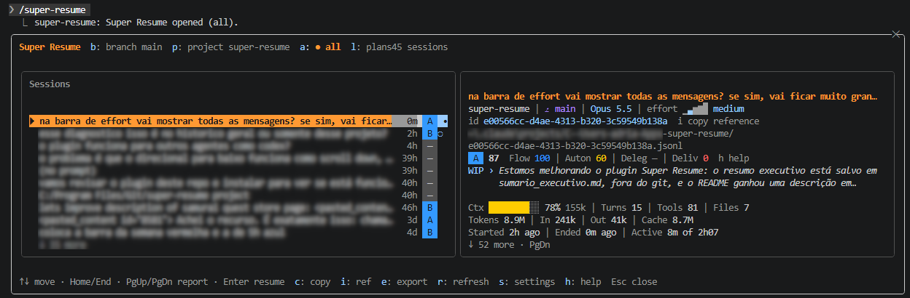

# Super Resume

A visual `/resume` for Claude Code. It opens a pane beside the chat that lists your past sessions on one side and shows a short report of the highlighted one on the other, so you can tell where a session stopped, and whether it holds what you are looking for, without opening it.



`/resume` shows one line and a timestamp per session. When you work on several fronts at once, often without a branch per front, that is not enough to find your place. Super Resume reads the transcripts Claude Code already keeps in `~/.claude/projects/` (read-only) and turns each into a small report.

**At a glance**
- **Find your place**: the last prompt and reply (paragraphs and lists kept), the first prompt, and Claude's last recap of the session.
- **Judge a session**: a grade from Flow, Autonomy and Delegation, plus Deliv, how much of what it edited is committed.
- **See what happened**: rejections, interrupts and errors; subagents and background work; todos and tasks; plans and the files they touched; what git still holds uncommitted.
- **Follow plans across sessions**: every plan joined to the sessions that wrote or read it, recovered from the transcript when its file is gone, and exportable into the project.
- **Private and honest**: nothing leaves your machine and no model summarises anything. Every number comes from the transcripts and git. When Claude Code changes its transcript format, the score says it cannot judge (`?`) instead of reading the gap as a perfect session.

## What it shows

**Session list (left)**
- Title, the same one `/resume` shows (one you set, or the one Claude Code gave it; else its first prompt)
- How long ago it was last active
- Its grade (A to E, `—` too short to judge, `?` format not recognised)
- `◌` while background work it started never reported done, `•` on the session you are in now

**Session report (right)**, each section can be turned off in settings (`s`)
- Project, branch, model; the session id and its transcript path
- When it started, when it last moved, active time of wall time
- **Score**: the grade and three sub-scores, Flow, Autonomy and Delegation, plus Deliv (what got committed). See *Score* below.
- **WIP**: the last recap Claude Code wrote of the session, and background work still running
- Context used, turns, tool calls, files, tokens (the session's and its subagents')
- **Charts**: a sparkline of work per turn, and the share of replies at each effort level
- **Where it stopped**: your last prompt and Claude's last reply; **how it began**: the first prompt
- **Quality**: actions you rejected (with your last correction quoted), interrupts, tool errors, plan revisions, clarifications, compactions
- **Agents**: subagents started by type, background work (completed, failed, killed, open), depth, messages, skills, the subagents' share of tokens
- **Todos / Tasks**: the last TodoWrite list or TaskCreate/TaskUpdate task list, with progress; a long session without one gets a hint to track its work with tasks
- **Plans**: each plan it sent for approval, approved or sent back, how many files the plan names were touched
- **Uncommitted**: from git, now: of the files it edited inside its repository, the lines not committed, untracked files, and the share a commit since the session started touched (`●` marks dirty files in Files)
- Diff and the files edited

**Plans view** (`l`)
Every plan of the scope: the plans sessions sent for approval and the plan files in `~/.claude/plans` no session wrote. A plan is joined to the session that wrote it and to every later session that read or named its file, so you can see where it was implemented and how many of the files it names were touched, even when the file itself is gone (its text is recovered from the transcript). Enter resumes the latest session of the plan, `c` copies its path (its text when the file is lost), `e` exports it into the project, `<date>-<title>.md` under `docs/plans/` (configurable), with a header saying where it came from. Exporting never overwrites, and a session that later names the exported file stays joined to the plan.

**Find** (`f`)
Search every prompt you wrote and every reply of the scope, like ctrl+r in a shell: type words and the list becomes the messages that hold all of them, in any order, without regard to case or accents (`sessao` finds `sessão`). Newest first. The report shows the message where it sits: the session, the message before, the match, the message after. Enter asks what to do with it: `1` opens the whole conversation, as Enter in the list does; `2` copies a command that continues it from right after that message's turn, as a fork, so the original stays as it is (a `/rewind` in the opened conversation would drop everything after that message):

```
cd <project> && claude --resume <id> --fork-session --resume-session-at <message>
```

Nothing leaves your machine and no model runs: the words are matched in what the list already read. Tool calls and their output are not searched.

## Keys

| Key | |
| --- | --- |
| `b` `p` `a` | scope: this branch, this project (with its worktrees, as `/resume`), every project |
| `l` | plans view |
| `f` | find: search the messages of the scope (Esc leaves the field; `f` again back to the list) |
| `s` | settings: sections on or off, export folder (kept across sessions) |
| `h` | help: what each section and number means |
| `c` | copy `cd <project> && claude --resume <id>` (in plans: the plan path) |
| `i` | copy a reference to the session: title, id, project and transcript path, to paste into another conversation so Claude can read what was done there |
| `e` | export the plan into the project |
| `r` | refresh (and ask git again) |
| `w` `o` `q` `g` `t` `n` `u` `d` | jump in the report to Last, First, Quality, Agents, Todos, Plans, Uncommitted (git), Diff; again goes back to the top |

↑/↓ move through the list (Home/End the ends) and the report follows; the list shows the rows that fit, with a count of those above and below. A report taller than its box scrolls: PgDn/PgUp move it a page, the mouse wheel over it a few rows, and a row of jump keys above it takes you straight to a section. Enter resumes the session in this terminal (`/resume <id>`), as `/resume` does; a session of another folder (another project, or a worktree) has its `cd … && claude --resume` command copied instead, since a running session cannot change folder. Esc closes the pane.

## Score

Read from the transcript alone, so a session's grade is the same in the list and in its report.

- **Flow**: how smoothly it went. Starts at 100 and loses points, per 10 turns, for each action you rejected (12), interrupt (8), plan rejected without comment (10) and plan sent back with comments (3); tool failures take up to 60 more by their share of calls. A question you answered by asking back costs nothing.
- **Autonomy**: tool calls per turn, on a log scale: 1 per turn is 20, 30 or more is 100.
- **Delegation**: half the subagents' share of tokens (40% or more is full use), half the share of background work (agents and commands) that completed; with background commands and no subagent, only that share. A session that handed nothing off has no Delegation, and the grade is the mean of the other two with their weights scaled up.
- **Grade**: Flow 50%, Autonomy 25%, Delegation 25%; A 85+, B 70+, C 55+, D 40+, else E. `—` below 5 turns or 10 tool calls.
- **Deliv**, beside the grade but not in it: the share of the session's repository files a commit since it started touched. It comes from git now, so it is read for the selected session only.

The counts come from wording Claude Code writes in its transcripts for itself (refusal and interrupt phrases, task notifications), not from a public format. When a Claude Code update changes it, the parser notices: a refusal-like error it cannot classify, a notification it cannot read, or tool results no longer tied to their calls. The score then shows `?` with the reason instead of reading zero problems as a perfect session. A transcript written by a newer Claude Code release than the one the signals were checked with (2.1) is marked `~`. Every weight and threshold is in one table, `SCORE` in `hooks/parse.ts`, and the help page (`h`) is written from it.

## Usage

```
/super-resume            # last scope used (project by default)
/super-resume branch
/super-resume all
/super-resume plans      # open on the plans view
```

## Install

Requires Claude Code 2.1.329 or later, on every machine and environment you use it in: Windows, macOS, Linux and each WSL distribution keep their own install (`claude --version` to check, `claude update` to upgrade). From 2.1.323, `/plugin install` and `claude plugin update` skip a build outside that range; on an older build `/super-resume` says which version it found and opens nothing, since those builds cannot draw the pane's rows.

At the prompt of a Claude Code terminal session:

```
/plugin marketplace add adrmarabuco/super-resume
/plugin install super-resume@super-resume
```

Pick a scope when asked (user is the usual one), then `/reload-plugins`.

From a shell:

```
claude plugin marketplace add adrmarabuco/super-resume
claude plugin install super-resume@super-resume
```

In the desktop app: click **+** next to the prompt box, then **Plugins**, **Add marketplace** with `adrmarabuco/super-resume`, then **Add plugin**.

Outside fullscreen the pane opens above the prompt across the whole terminal: the list on the left half, the report on the right. In fullscreen with 110 columns or more Claude Code docks it beside the transcript, where a pane can take at most 45% of the width, so there the report sits under the list.

## How it works

It is a Claude Code mod: a hooks module (`hooks/register.tsx`) that registers the `/super-resume` command and draws a `Pane`. Transcripts up to 16 MB are read whole; larger ones are read as their first 2 MB and last 8 MB, and their counts are shown as lower bounds (`≥`). Git is asked only about the selected session, and only for the files it edited. Context use is the input tokens of the last reply (fresh + cache), against a 200k window, or 1M when the model or the usage says so.

Nothing is sent anywhere or summarised by a model: every number comes from the transcript files and git. The only thing it writes is a plan you export, into the project folder you chose.

## Roadmap

- Group sessions by front (topic), inferred from what they discuss and the files they touch, not from branches
- Optional one-line AI summary per session, cached
- Resume a session of another project folder without the copy and paste

## Development

```
claude --plugin-dir ./super-resume   # load from disk; edits hot-reload
claude plugin validate .
claude plugin test .
```

## License

MIT
